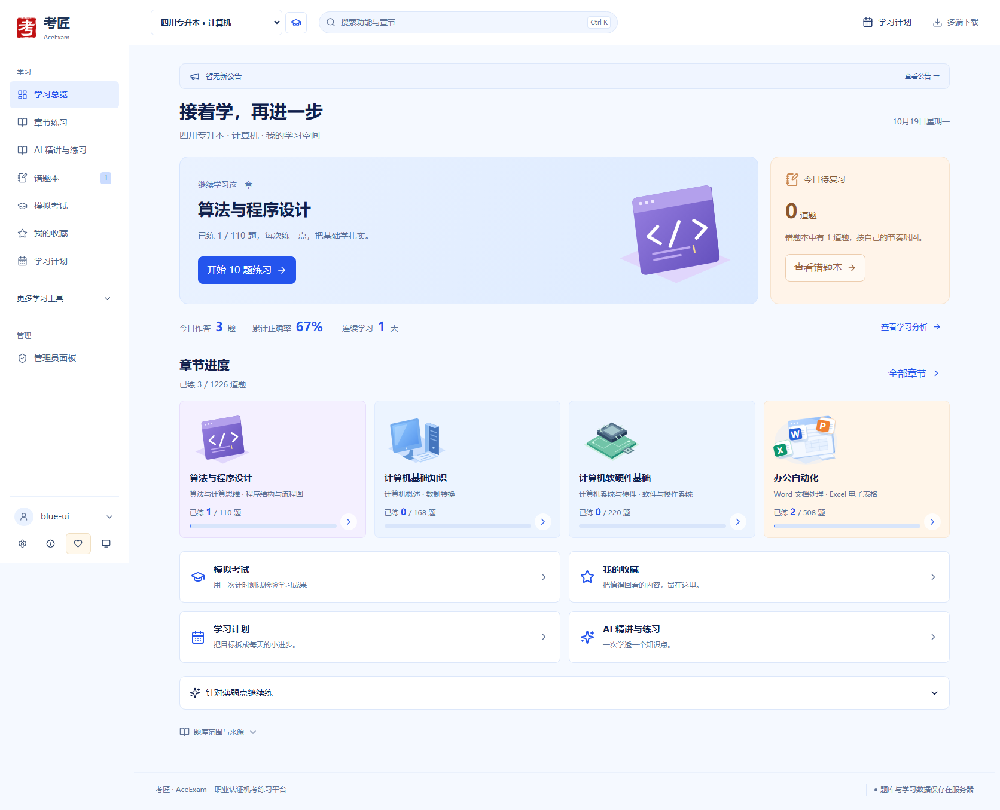
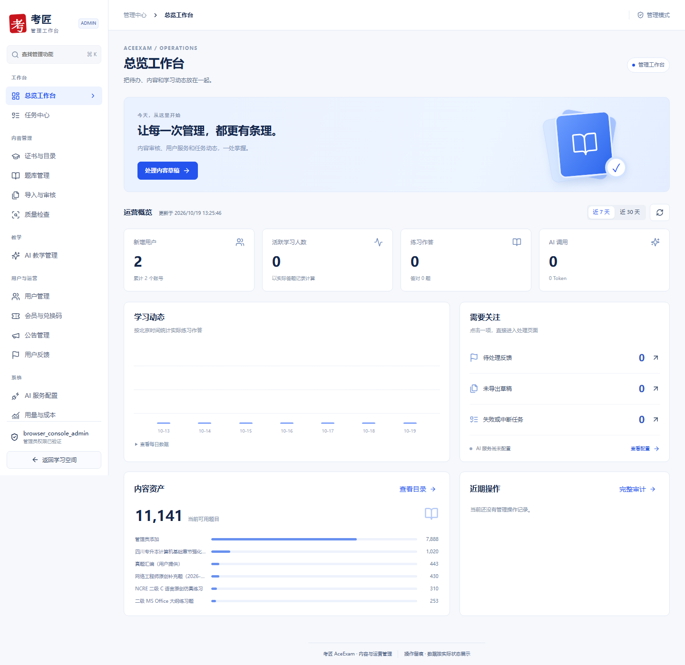

# 考匠 AceExam

**把每一道题，学成你的底气。**

考匠是面向职业认证与升学考试的练习平台，把章节刷题、错题复习、模拟考试、分步 AI 精讲和学习计划放在同一个学习空间。网页、Android 与苹果手机网页版共用账号和学习数据；用户生成的题目经校验、审核和确认投稿后，可供同证书的其他用户练习。

[访问考匠](https://aceexam.top/) · [多端入口](https://aceexam.top/#downloads) · [本次大更新](docs/releases/2026-10-19-web-admin.md) · [管理员工作台](docs/admin-console.md) · [部署与升级](#部署与升级) · [历史更新](CHANGELOG.md)

> **2026-10-19 · Web 学习空间与管理后台大更新。** 本次更新代码及说明，不代表生产网站已经部署；Android 沿用既有 v0.4.6 发布版本，不发布新 APK。其他工作区中的 App 0.4.7、兽医题库整理和未完成的补题批次不纳入本次提交。具体通过了哪些检查，以[本次验收记录](docs/releases/2026-10-19-web-admin.md#验收与发布状态)为准。

## 这次更新带来了什么

### 一个连贯的学习空间

- **蓝白界面**：公开首页、登录、学习总览、章节、刷题、错题、考试、收藏、计划、会员、证书选择和设置采用统一布局。桌面与窄屏分别安排内容，支持深色外观、阅读字号和减弱动画。
- **从上次的位置继续**：首页展示真实作答与章节进度，继续练习恢复当前账号、当前证书的学习位置；章节大图和小图保持一致，悬停或键盘聚焦时显示有限动效。
- **按需要选题**：按章节、二级分类、知识点和来源筛选，选择顺序或随机、全部或未练等范围；错题本先进入总览，再由用户选择复习内容。
- **有保存状态的模拟考试**：按知识点组卷，设置题量和时长；支持暂存、刷新恢复、倒计时、答题卡、成绩和考后解析。跨设备作答冲突会明确提示。
- **可持续的复习**：题目收藏与知识点收藏分开管理；计划任务和完成情况来自真实学习记录。每日提醒时间随账号保存，在网页打开且可见时触发，不承诺关闭网页后推送。



截图使用隔离测试账号；题量、进度和统计以实际账号与所选证书为准。

### 一步一步学的 AI 精讲

先讲一个概念，再做一道检验理解的小题；答错后进入对应补课和变式验证，最后记录学习进度。课程包含讲解卡片、知识卡片、对比表、受控 SVG 图解、小测、反馈和进度。

标准答案与评分规则由服务端持有，答题前不下发；前端只按允许的组件协议渲染，不执行 AI 返回的 HTML、JavaScript 或 React 代码。学习会话可以恢复，课程更新、停用和会员到期会重新检查权限。

首批网络工程师内容包含 **39 节完整互动课、1 节明确标识的 VLAN 部分示范**；其余 107 节保留原有精讲，不宣称已经全部互动化。普通课程播放和确定性判分不调用模型，老师答疑按现有账号额度调用网关。详见 [Web 学习系统说明](docs/web-next-release.md)。

### 可扩展的管理工作台

管理员从 `/#admin/overview` 进入独立后台，原 `#admin` 和教学管理入口继续兼容。后台沿用现有管理员权限，管理证书筛选不会改变管理员自己的学习目标。

15 个模块按工作组织：

- **工作台**：7 / 30 天总览、待处理事项、学习趋势、题库来源、近期操作和任务中心。
- **内容管理**：证书三级目录、覆盖缺口、题库搜索与通配符、完整预览、修订草稿、批量核对导出、下架恢复、JSON 批次导入、质量检查和发布包导出。
- **教学管理**：既有课程目录、生成审核、发布停用、判分申诉，以及静态互动课的版本、覆盖和预览。
- **用户运营**：账号资料、封禁解封、会员权益、兑换码生成与导出、公告编辑发布、反馈状态和处理备注。
- **系统管理**：有效 AI 配置来源、调用与 Token、已知费用和未知费用次数、任务进度、审计检索与运行状态。

列表支持搜索、分页、筛选恢复和操作反馈；重要写入检查版本，冲突时要求刷新。下架先预览影响，保留原题及学习历史；任务、草稿和处理记录持久保存。密钥不会回传、进入审计明文或导出文件。详见 [后台使用与维护](docs/admin-console.md)。



## 题库如何增长

```text
错题与知识点定位 → AI 变式生成 → 结构校验与查重
                  → 独立复核 → 用户确认投稿 → 同证书共享练习
                  → 质量反馈 → 后续修订
```

共享的是题目内容，个人作答、错题、掌握度和老师对话按账号隔离。共享 AI 题有独立来源，不会自动成为内置题或进入正式模拟题池；程序与 AI 审核也不等于专家逐题认证。

内置题库位于 `server/question-banks/`，通过 `manifest.json` 声明证书、来源和三级目录，题量由当前版本的实际加载结果决定。新增证书只有在清单与题目接入后才显示，界面预留图标不代表题库已经发布。

```sh
npm run bank:validate
npm run bank:report
```

内置题修改采用 **网页编辑 → 隔离草稿 → 证据与独立复核 → 质量检查 → 导出发布包 → 接入代码 → 验收部署**。审核不通过不能导出可发布内容；草稿保存、发布包下载与运行库生效是不同状态。

修订题使用新 ID 并绑定原题摘要。发布时保留旧题、答题和考试记录，旧版本退出新练习。新增或修改内容前须阅读 [题库操作规范](docs/AI-QUESTION-BANK-OPERATIONS.md) 和 [内容工作流](.agents/skills/kaojiang-content-pipeline/SKILL.md)。

## 快速开始

需要 **Node.js 24+**。完整 Web 构建同时包含电脑网页与 `/app/` 手机网页，因此需要安装两处依赖。

```sh
npm ci
npm ci --prefix mobile
node scripts/setup.js
npm run build
npm start
```

访问 `http://127.0.0.1:5173`。首次注册后选择备考方向；首次账号按现有规则取得管理员权限，正式运行建议用 `ADMIN_USERNAME` 明确指定管理员。已有账号与权限沿用数据库记录。

日常开发使用 `npm run dev`。`scripts/setup.js` 生成被 Git 忽略的 `.env` 和随机加密主密钥，不覆盖已有 `.env`。AI 服务不是普通刷题、错题复习和考试的启动前提。

### 隔离预览

```sh
node scripts/preview-web-blue.mjs
npm run preview:admin
```

- 学习空间：`http://127.0.0.2:4178/preview/start`
- 管理后台：`http://127.0.0.3:4179/preview/start`

两者使用各自的本地演示库和账号，收费 AI 未连接。预览入口只绑定本机，不是正式服务的登录后门，也不表示演示会员权益在真实账号生效。

## 配置与账号

配置字段见 [.env.example](.env.example)。常用项：

- `PORT`、`BIND_HOST`、`ALLOWED_HOSTS`：监听端口、绑定地址与允许访问的 Host。
- `DATA_DIR`：SQLite、头像、上传文件和其他持久数据所在目录。
- `AI_MASTER_KEY`：服务端加密主密钥，升级时必须保留；丢失后无法解密已保存的 AI Key。
- `AI_SERVICE_API_KEY`、`AI_SERVICE_BASE_URL`、`AI_SERVICE_MODEL`：共享作者 AI 服务；环境配置优先于数据库配置，管理员可以查看实际生效来源。
- `ADMIN_USERNAME`：明确指定管理员账号。
- `TRUST_PROXY`、`COOKIE_SECURE`：可信反向代理与 HTTPS Cookie 设置。

普通用户无需填写 AI Key。服务端兼容 Chat Completions 网关，并保存额度、任务与调用记录；只有配置了匹配模型的价格时才估算费用，没有价格显示“未知”，不能当作免费。

**邮箱验证默认关闭**：保留验证码注册与找回密码代码，`AUTH_EMAIL_VERIFICATION_ENABLED=0`。未配置并验证发信服务前不启用，也不宣称仅填写邮箱即可证明邮箱归属。现有账号密码登录、登录后改密与老账号恢复说明见 [账号与邮箱配置](docs/account-email-verification.md)。

不要提交 `.env`、用户数据库、真实验证码、API Key、签名材料或私人上传文件。

## 技术栈与目录

- **电脑 Web**：React 19、Vite 7、Lucide，使用现有 hash 路由与响应式 CSS。
- **服务端**：Node.js 24、Express 5、SQLite（`node:sqlite`）、Zod；复用现有服务与增量建表方式。
- **移动端**：Expo / React Native；Android 和 `/app/` 手机网页共用源码，微信小程序复用同一后端。
- **AI**：服务端网关、结构化验证、缓存、限流、额度与用量记录；密钥不进入前端。

```text
src/features/                学习、考试、收藏、计划、设置等页面
src/features/admin/          后台注册表、独立模块与通用组件
src/generated/               可信本地插画与教学渲染资源
server/admin-console/        后台 API、持久任务与运营统计
server/content-quality/      网页与命令行共用内容检查
server/question-banks/       内置题库、目录与来源记录
server/demo-tutor/           分步教学协议、引擎与审核内容
mobile/                      Android 与手机网页源码
miniprogram/                 微信小程序源码
scripts/                     构建、内容导出、隔离预览与验收
test/                        单元、接口及浏览器测试
docs/                        架构、产品规则与部署说明
```

后台通过 `src/features/admin/registry.jsx` 声明导航、路由、懒加载入口及权限；新功能作为独立模块加入。新增接口集中在 `/api/admin/console/*`，既有 App 管理接口继续兼容。更多入口见 [架构地图](docs/ARCHITECTURE-MAP.md)，其中旧快照以当前源码为准。

## 验证

首次运行浏览器测试前安装 Chromium 与 WebKit：

```sh
npx playwright install chromium webkit
npm run verify
```

需要单独验证时：

```sh
npm test
npm run typecheck
npm run build
npm run verify:web-blue
npm run verify:admin
```

`verify` 检查题库、类型、单元与接口、完整构建和浏览器流程。`verify:web-blue` 覆盖蓝色学习区，`verify:admin` 覆盖后台操作与共用服务；报告保存在 `test-output/`。测试使用隔离数据和模拟 AI，不使用生产账号或消耗真实模型额度。

本次隔离候选的 **18 个发布检查阶段全部通过**，包含 298 项单元与接口测试、25 项内容质量检查、17 项 Web 专项和 15 个后台模块的浏览器验收。[机器可读验收摘要](docs/releases/2026-10-19-verification.json) 随代码保存。

通过本机构建、测试或推送 GitHub，不代表真实模型、线上网站或手机真机验收已完成。最新结果与保留问题集中记录在 [本次更新说明](docs/releases/2026-10-19-web-admin.md#验收与发布状态)。

## 部署与升级

先备份完整 `DATA_DIR` 和 `.env`，SQLite 备份要保证一致性；停止服务后复制完整数据目录是最直接的方式。不要用本地演示库替换线上数据，不要用清库刷新题库。

在现有项目中更新到已核对的代码版本，然后：

```sh
npm ci --include=dev
npm ci --prefix mobile --include=dev
npm run build
```

通过检查后，用现有服务管理方式重启 Node；生产环境运行 `npm start`。HTTPS 反向代理下按实际环境设置 `ALLOWED_HOSTS`、`TRUST_PROXY=1` 和 `COOKIE_SECURE=1`。

部署必须同步完整 `dist/`（含 `dist/app/`）与 `server/`，并保留原 `.env`、主密钥、数据库、公告、头像和上传内容。后台草稿、任务、反馈处理和下架记录在当前 `DATA_DIR` 内增量保存，不需要另开数据库。

上线后用普通账号和管理员分别核对登录、章节练习、考试恢复、权限拒绝、草稿保存、公告与会员接口。回退代码时继续保留新增表和原数据，不做破坏性回滚。详细步骤见 [本次升级说明](docs/releases/2026-10-19-web-admin.md#升级与回退)。

## 其他端与内容边界

Android 安装、签名与开发说明见 [mobile/README.md](mobile/README.md)；苹果手机网页版见 [apple-web.md](docs/apple-web.md)；微信接入见 [miniprogram/README.md](miniprogram/README.md)。这次 Web 更新不改变 App 发布版本或小程序发布状态。

考匠是独立学习工具，不代表考试主管单位。原创仿真题、用户提供资料和共享 AI 题按来源标注，不承诺押题或保证答案无误；正式考试范围、报名和规则以主管机构公告为准。发现题目问题可通过页面反馈进入修订流程。
